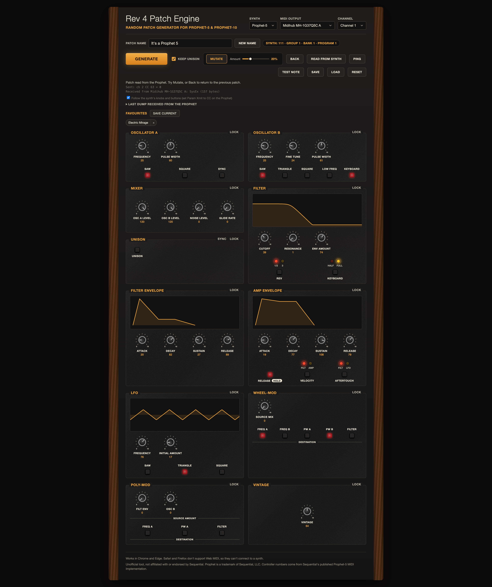

# Rev 4 Patch Engine for Prophet-5 and Prophet-10

A free, browser-based random patch generator and editor for the Sequential Prophet-5 and Prophet-10 (Rev 4). Generate a new patch, nudge the current one with Mutate, tweak any control, and read the patch that's on the synth into the app.

**Try it:** https://opt-fx.github.io/rev4-patch-engine/

**Unofficial tool. Not affiliated with or endorsed by Sequential. Prophet is a trademark of Sequential, LLC.**

## What you need

- **Chrome or Edge.** Safari and Firefox don't support Web MIDI, so they can't talk to a synth.
- A MIDI route from your computer to the synth (USB or a MIDI interface).
- On the synth, in Globals: **Param Rcv** set to **CC**. For Read from synth, also set **MIDI SysEx** to the route you use (MIDI or USB) and make sure MIDI Out is sending on that route.
- To have the app follow knobs and buttons you move on the synth, also set **Param Xmit** to **CC** in Globals. NRPN isn't supported for this.

## Using it

1. Open the page and click **Allow** when the browser asks for MIDI (and SysEx) access.
2. Pick your synth model (Prophet-5 or Prophet-10), your MIDI output, and your MIDI channel. The app tries to recognise a Prophet-5 automatically.
3. Press **Test note** to check the connection.
4. **Generate** makes a new random patch. **Mutate** nudges the current one by the chosen amount. **Back** undoes up to 20 steps.
5. Every knob and button sends to the synth as you move it.
6. **Read from synth** pulls the current patch (including its name and unison settings) into the app. With Param Xmit set to CC, knobs and buttons you move on the synth then move on screen too (untick "Follow the synth's knobs and buttons" to stop that). After changing program on the synth, press Read from synth again to load the new patch.
7. **Lock** on a section keeps it unchanged when you Generate or Mutate. **Keep unison** keeps your unison settings through Generate.
8. **Save** and **Load** use small JSON files. **Favourites** are stored in your browser only.

Knobs: drag up or down (hold Shift for fine control), use the mouse wheel or arrow keys while a knob is focused, double-click to reset.

## Notes and limits

- Controller numbers come from Sequential's published Prophet-5 MIDI Implementation (v1.4).
- Rev (filter type), Velocity and Aftertouch routing are stored with each patch on the synth. Generate, Mutate and Reset leave them alone so they can't override your setup, and they're only sent once you've pressed their button or read from the synth.
- When you select a program on the synth, the app shows its number (for example "113") next to the patch name, as long as the synth is sending Program Change and Bank Select.
- Unison chord notes can't be set over MIDI, so the app only handles on/off, voice count and detune.
- **Prophet-10:** the app uses the same controller numbers and dump layout as the Prophet-5, because Sequential publishes one MIDI document for both. That hasn't been verified on a Prophet-10. If something reads or sends wrongly, please open an issue.
- Safari and Firefox users can still look at the page, but can't connect to a synth.
- Developed and tested on a Prophet-5 Rev 4 (OS 2.1.0) with a Blokas Midihub. Other setups should work but haven't been tried.
- Unison detune isn't listed in Sequential's documentation. It sits at byte 54 of the unpacked edit-buffer SysEx dump (unison on is byte 52, voice count byte 53, counted from zero so 0 means one voice), found by comparing dumps.

## Troubleshooting

- **No MIDI outputs listed:** use Chrome or Edge and allow MIDI access when asked. If you blocked it earlier, click the padlock in the address bar and allow it.
- **Knobs move but the synth doesn't respond:** check Param Rcv is set to CC in Globals and that the MIDI channel matches.
- **"No reply from the Prophet" on Read from synth:** check MIDI SysEx in Globals matches your route, and that nothing in between (a MIDI router such as a Midihub) is filtering SysEx in either direction.

## Running it

It's a single HTML file with no dependencies. Open it in Chrome, or host it anywhere that serves static files, such as GitHub Pages. MIDI access needs a secure (https) page or a local file.

## Licence

Released under the MIT licence (see the LICENSE file). Made by OPT.
